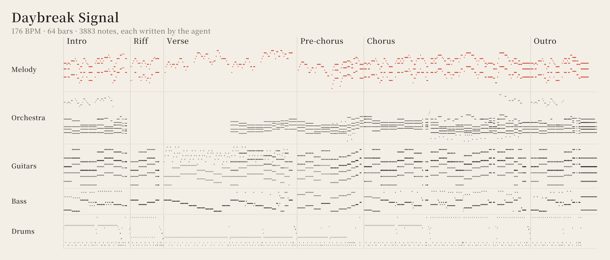

<p align="center">
  <picture>
    <source media="(prefers-color-scheme: dark)" srcset="assets/brand/logo-dark-1200.png">
    
  </picture>
</p>

<p align="center">
  <a href="README.md">English</a> ·
  <strong>繁體中文</strong> ·
  <a href="README.zh-CN.md">简体中文</a> ·
  <a href="README.ja.md">日本語</a> ·
  <a href="README.ko.md">한국어</a>
</p>

<p align="center">
  <a href="https://github.com/owoevan-dev/music-skill/actions/workflows/tests.yml"></a>
  <a href="LICENSE"></a>
  
</p>

<p align="center"><strong>不是生成，是作曲。</strong></p>

music-skill 是一個 [Agent Skill](https://agentskills.io)，讓 AI agent 像作曲家加上一間小錄音室那樣，寫出原創的器樂曲。每一個音都由 agent 寫下，skill 負責檢查樂譜、用取樣樂器演奏、混音和母帶後製。

整個過程沒有用到任何音訊生成模型。除了 MP3 和 WAV，你還會拿到 MIDI、每個聲部各自的音軌，以及一份專案檔：裡面任何一個音都能改，改完再重新渲染。

<p align="center">
  
</p>

## 試聽

《Daybreak Signal》是一首動漫片頭風格的器樂曲，TV 尺寸：87 秒、176 BPM，進副歌時上移小三度轉調。由 Claude（Opus 5.5）用這個 skill 作曲、編曲和混音，之後又修改過：減少停頓、讓主旋律連貫，並另外做了一版鋼琴主旋律。

- [鋼琴主旋律](examples/daybreak-signal/piano.mp3)
- [電吉他主旋律](examples/daybreak-signal/guitar.mp3)

兩個版本只差在主旋律的樂器。[examples/daybreak-signal](examples/daybreak-signal) 裡有寫出這首曲子的腳本，以及兩份專案檔。在 Windows 上用鎖定版本的工具重新渲染，會得到相同的母帶，差異只在 24 位元的四捨五入。

## 為什麼不直接生成？

文字轉音樂的模型交給你的是一段做好的音訊。只要有一小節不對，就得重新生成，換來的是另一首歌。你沒辦法打開它移動一個音，也說不出裡面的聲音從哪裡來。

這裡由 agent 寫出樂譜，所以音樂是由一個個你看得懂、改得動的決定組成：第 33 小節的旋律、一個和弦的配置、鼓手敲銅鈸的力道。只改一個音，就只會重新渲染那個聲部。聲音來自真實樂器的多重取樣錄音，授權都查得到，也沒有用到任何以別人錄音訓練的模型。

## 運作方式

1. **寫譜**：agent 先規劃曲式和主題，再寫出專案檔。每個音的音高和長度記在樂譜裡；怎麼演奏（力度、時間點、放開的時機）另外記錄。較長的曲子通常由 agent 寫一支簡短的 Python 腳本來產生，讓和聲配置、貝斯線和鼓的樂句都清楚好改。
2. **檢查樂譜**：`review` 會列出聲部之間持續的小二度和小九度，以及落在和弦外的旋律音，讓每一處都是刻意的選擇，而不是意外。
3. **演奏**：演奏模型加上真人演奏會有的偏差：每位樂手在時間和音量上緩慢的起伏、稍微拖拍的貝斯、樂句的起伏弧線，以及和弦裡各音不會同時按下、也不會同時放開。取樣的主旋律可以圓滑奏，也可以推弦。
4. **渲染**：FluidSynth 用有授權的 SoundFont 音色庫，讓每個聲部用各自的樂器演奏。
5. **混音與母帶**：各聲部經過鼓、貝斯、節奏、合奏和主旋律匯流排，以及四種自動生成的殘響，最後由母帶處理做到 −14 LUFS，真峰值不超過 −1 dBTP。管弦樂與管風琴可以略過壓縮器，保留完整的強弱對比。
6. **量測**：`analyze` 會量出每個段落的響度、頻譜和立體聲，以及主旋律比伴奏大聲多少。這些數字能指出問題所在，但不能取代實際聆聽。

只改一個音，就只會重新渲染那一個聲部；只改混音，則完全不用重新渲染。

遊戲用的專案可以設定循環：渲染時會把殘響尾巴折回循環開頭，並用 Godot 和 RPG Maker 讀取的格式，把循環點寫進 WAV 與 Ogg 檔，每個段落也標上提示點。循環還能拆成幾層，各層加起來就是完整混音，讓音樂隨著遊戲緊張程度逐層加厚。

## 安裝

**Claude Code**

```
/plugin marketplace add owoevan-dev/music-skill
/plugin install music-skill@music-skill
```

**Codex 與其他 agent**

```
npx skills add owoevan-dev/music-skill
```

也可以直接把 `skills/music-production` 複製到 agent 的 skills 資料夾。

**渲染工具**：每台電腦設定一次，可以交給 agent 代勞。

Windows x64 會下載鎖定版本的 FluidSynth 和 FFmpeg 免安裝版：

```
python skills/music-production/scripts/bootstrap.py --runtime <folder>/.runtime --config <folder>/local-config.json
```

Linux（Ubuntu 24.04、Debian 13 或更新）和 macOS 使用系統套件：

```
sudo apt install fluidsynth ffmpeg libarchive-tools        # macOS：brew install fluid-synth ffmpeg
python3 skills/music-production/scripts/bootstrap.py --system --runtime <folder>/.runtime --config <folder>/local-config.json
```

接著下載示範曲用到的樂器，約 1 GB：

```
python skills/music-production/scripts/fetch_soundbanks.py --config <folder>/local-config.json --runtime <folder>/.runtime --output <folder>/local-config.studio.json
```

需要 Python 3.10 以上和 NumPy。不需要 GPU、帳號或音訊模型。所有檔案都從發布者自己的頁面下載，並以鎖定的 SHA-256 核對。

## 使用方式

直接用平常的話告訴 agent：

> 幫我的益智遊戲標題畫面寫一首 90 秒的器樂曲，溫暖、帶點憂傷，用鋼琴和弦樂。

> 做一首 TV 尺寸的動漫片頭風格曲子，吉他樂團配鋼琴主旋律。

> 幫我的視覺小說寫一段悲傷場景的循環配樂：柔和的鋼琴和大提琴，安靜到可以邊聽邊讀。

> 寫兩分鐘的管弦樂：日出，從安靜的法國號獨奏到整個樂團。

> 第 33 小節的副歌旋律太忙了，簡化一下再重新渲染。

> 也把 MIDI 和分軌給我。

## 音色庫

| 樂器 | 音色庫 | 授權 |
|---|---|---|
| 平台鋼琴 | VCSL 的 Steinway B（Versilian Studios）；Osiris Piano（Karoryfer Samples），分別錄了踩與不踩延音踏板的版本；兩者都在這裡建置 | CC0 |
| 電吉他 | FreePats FSBS：兩種破音、一種乾淨音色 | CC0 |
| 電貝斯 | Bass YR，撥片與指彈，取樣由 Andrea Biasior 錄製；Black And Blue Basses（Karoryfer Samples）的五弦貝斯，含幽靈音，在這裡建置 | CC0 |
| 爵士鼓 | Big Rusty Drums（Karoryfer Samples），在這裡建置成 GM 鍵位 | CC0 |
| 弦樂（含震音與撥奏）、獨奏小提琴、低音提琴、銅管、小號、法國號、長號、低音號、木管、短笛、鐘琴 | 由 VSCO 2 Community Edition（Versilian Studios）建置 | CC0 |
| 豎琴、馬林巴、顫音琴、木琴、管鐘、定音鼓、管弦打擊樂（鈸與鈸的漸強、鑼、三角鐵、雪橇鈴、風鈴）、管風琴 | 由 VCSL（Versilian Studios）建置 | CC0 |
| 獨奏大提琴 | Karoryfer x bigcat cello（Karoryfer Lecolds 與 bigcat instruments），連同原有的持續音循環點在這裡建置 | CC0 |
| 其他樂器 | MuseScore MS Basic | MIT |

錄音音色庫全都是 CC0，用它們做的音樂不需要署名。MS Basic 的 MIT 聲明只跟著音色庫本身的副本，不及於用它渲染出來的音樂。來源列在 [THIRD_PARTY.md](THIRD_PARTY.md)。

## 效果如何

`selfcheck.py` 共有 46 項檢查，從 MIDI 來回轉換、壓縮檔安全，到實際渲染都包括在內。例如：只改一個音時只會重新渲染一個聲部；舊的單一殘響混音能逐位元重現先前的版本；響度量測對 BS.1770 的標準測試音讀出 −3.01 LUFS。CI 會跑完所有檢查（包括渲染），環境是 Ubuntu（FluidSynth 2.3、FFmpeg 6.1）和 macOS（FluidSynth 2.6、FFmpeg 9.0）。

音樂好不好聽是另一回事，只有實際聆聽才知道。上面的示範曲是這個 repo 最好的證據。

## 限制

- 不會唱歌、不寫歌詞，也不支援 VST 外掛。
- 音色的上限取決於免費音色庫：YR 貝斯只有一層力度，弦樂起音偏慢，馬林巴、木琴與短笛的取樣稀疏，取樣吉他的推弦是把整段取樣變調，不會有真實琴弦的音色變化。
- agent 聽不到聲音。`review` 和 `analyze` 只能找出問題，結果必須由人來聽；skill 也會要求 agent 不得宣稱自己聽過。
- Linux 和 macOS 使用系統的 FluidSynth 和 FFmpeg，渲染出的取樣可能和 Windows 的鎖定版本有些微差異。

## 文件

| | |
|---|---|
| [SKILL.md](skills/music-production/SKILL.md) | agent 依循的工作流程，以及所有指令 |
| [schema.md](skills/music-production/references/schema.md) | 專案檔：樂譜、演奏與混音 |
| [arrangement.md](skills/music-production/references/arrangement.md) | 曲式、旋律、和聲配置與各聲部的職責 |
| [performance-and-mix.md](skills/music-production/references/performance-and-mix.md) | 演奏、匯流排混音，以及如何解讀 `analyze` |
| [soundbanks.md](skills/music-production/references/soundbanks.md) | 各音色庫的特性與限制，以及如何加入自己的音色庫 |
| [setup.md](skills/music-production/references/setup.md) | 在 Windows、Linux 和 macOS 安裝渲染工具 |
| [sources-and-rights.md](skills/music-production/references/sources-and-rights.md) | 使用外部樂譜、MIDI 與取樣的注意事項 |

文件本身以英文撰寫。

## 參與貢獻

歡迎在 [Issues](https://github.com/owoevan-dev/music-skill/issues) 回報錯誤、提供試聽意見或推薦音色庫。目前不接受專案外部的 Pull Request，原因和替代做法寫在 [CONTRIBUTING.md](CONTRIBUTING.md)。

## 授權

程式碼與文件採用 [MIT](LICENSE) 授權。示範錄音與樂曲本身以 [CC0 1.0](https://creativecommons.org/publicdomain/zero/1.0/) 釋出到公有領域。第三方工具和音色庫保留各自的授權，由使用者從發布者處下載，不包含在這個 repo 裡。曲子的那張圖是程式直接從鋼琴版的專案檔畫出來的；logo 的文字是將 Noto Serif TC（SIL Open Font License）轉成外框。
