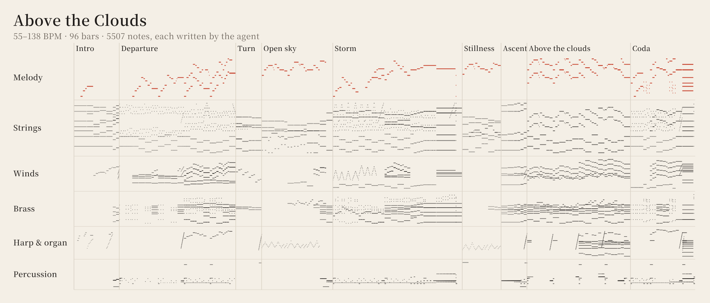

<p align="center">
  <picture>
    <source media="(prefers-color-scheme: dark)" srcset="assets/brand/logo-dark-1200.png">
    
  </picture>
</p>

<p align="center">
  <a href="README.md">English</a> ·
  <strong>繁體中文</strong> ·
  <a href="README.zh-CN.md">简体中文</a> ·
  <a href="README.ja.md">日本語</a> ·
  <a href="README.ko.md">한국어</a>
</p>

<p align="center">
  <a href="https://github.com/owoevan-dev/music-skill/actions/workflows/tests.yml"></a>
  <a href="LICENSE"></a>
  
</p>

<p align="center"><strong>不是生成，是作曲。</strong></p>

music-skill 是一個 [Agent Skill](https://agentskills.io)，讓 AI agent 像作曲家加上一間小錄音室那樣，寫出原創的器樂曲。每一個音都由 agent 寫下，skill 負責檢查樂譜、用取樣樂器演奏、混音和母帶後製。

整個過程沒有用到任何音訊生成模型。除了 MP3 和 WAV，你還會拿到 MIDI、每個聲部各自的音軌，以及一份專案檔：裡面任何一個音都能改，改完再重新渲染。

<p align="center">
  
</p>

## 試聽

**[《Above the Clouds》](examples/above-the-clouds)**：為管弦樂團與管風琴寫的音樂會序曲。從遠方的法國號開始，經過快板、暴風雨和一段寧靜的小提琴獨奏，最後管風琴加入，以最強音奏出主題大旋律。可以聽[整首序曲](examples/above-the-clouds/above_the_clouds.mp3)（4:28），或[最後 1:41](examples/above-the-clouds/above_the_clouds_highlight.mp3)。

**[《Signal Fire》](examples/genre-demos/signal_fire.mp3)**：節慶浩室（festival house）。鋼琴主題、漸強段和 supersaw 的爆發段（drop），都用這個 skill 內建的合成器和鼓機做成。

其他風格都在 [examples/genre-demos](examples/genre-demos)：

- [《Late Set at the Corner》](examples/genre-demos/late_set.mp3)：次中音薩克斯風加鋼琴三重奏的爵士藍調
- [《Midnight Coastline》](examples/genre-demos/midnight_coastline.mp3)：synthwave，滑音主旋律配上弦樂合成器鋪底
- [《Rain on the Tram Line》](examples/genre-demos/tram_line_rain.mp3)：lo-fi hip-hop，老舊磁帶味的鋼琴和弧頂爵士吉他
- [《Paper Satellites》](examples/genre-demos/paper_satellites.mp3)：future bass，隨大鼓起伏的 supersaw 和弦與 808
- [《Pixel Lantern》](examples/genre-demos/pixel_lantern.mp3)：照紅白機（NES）的限制寫成的遊戲地圖循環配樂

每一首都由 Claude（Opus 5.5）用這個 skill 作曲、編曲和混音。每個範例資料夾都有寫出曲子的腳本和專案檔；在 Windows 上用鎖定版本的工具重新渲染，會得到相同的母帶，差異只在 24 位元的四捨五入。[《Daybreak Signal》](examples/daybreak-signal) 是一首由鋼琴主奏的動漫片頭風格曲子，示範一首曲子怎麼一步步修改。

## 快速開始

1. 安裝這個 skill。在 Claude Code 裡：

   ```
   /plugin marketplace add owoevan-dev/music-skill
   /plugin install music-skill@music-skill
   ```

   Codex 和其他 agent：`npx skills add owoevan-dev/music-skill`。
2. 請 agent 安裝渲染工具和音色庫。它會執行[安裝](#安裝)一節的指令：下載約 3.6 GB，在我們的測試電腦上接著約五分鐘就完成其餘步驟。
3. 用平常的話點一首曲子：

   > 幫我的 RPG 寫一首一分鐘、可以循環的城鎮主題：直笛、豎琴和輕柔的弦樂。

你會拿到 MP3 和 WAV、MIDI、每個聲部的分軌，以及專案檔。在一台 24 執行緒的筆電上，上面的範例從半分鐘（爵士三重奏、chiptune 循環曲）到五分鐘（用內建合成器做的浩室）就渲染完成；四分半的序曲花了三分鐘。

## 為什麼不直接生成？

文字轉音樂的模型交給你的是一段做好的音訊。有些可以重新生成其中一段，但你沒辦法打開它移動一個音，也說不出裡面的聲音從哪裡來。

這裡由 agent 寫出樂譜，所以音樂是由一個個你看得懂、改得動的決定組成：第 33 小節的旋律、一個和弦的配置、鼓手敲銅鈸的力道。只改一個音，就只會重新渲染那個聲部。聲音來自真實樂器的多重取樣錄音（授權都查得到）或 skill 內建的合成器，也沒有用到任何以別人錄音訓練的模型。

如果 Claude 或其他 agent 已經在幫你剪影片或做遊戲，它本來就知道音樂要配合什麼：每個場景多長、轉場落在哪裡、旁白何時開始、關卡怎麼循環。它可以照著這些數字寫：在揭曉的那一刻推到最高點、旁白底下的配樂收小、循環和關卡一樣長；剪輯改了，就只重寫移動到的那幾小節。

## 運作方式

1. **寫譜**：agent 先規劃曲式和主題，再寫出專案檔。每個音的音高和長度記在樂譜裡；怎麼演奏（力度、時間點、放開的時機）另外記錄。較長的曲子通常由 agent 寫一支簡短的 Python 腳本來產生，讓和聲配置、貝斯線和鼓的樂句都清楚好改。
2. **檢查樂譜**：`review` 會列出聲部之間持續的小二度和小九度，以及落在和弦外的旋律音，讓每一處都是刻意的選擇，而不是意外。
3. **演奏**：演奏模型加上真人演奏會有的偏差：每位樂手在時間和音量上緩慢的起伏、稍微拖拍的貝斯、樂句的起伏弧線，以及和弦裡各音不會同時按下、也不會同時放開。取樣的主旋律可以圓滑奏，也可以推弦。
4. **渲染**：FluidSynth 用有授權的 SoundFont 音色庫，讓每個取樣聲部用各自的樂器演奏；電子聲部則由內建的合成器和鼓機，或 Surge XT 合成器的音色演奏。
5. **混音與母帶**：各聲部經過鼓、貝斯、節奏、合奏和主旋律匯流排，以及四種自動生成的殘響，最後由母帶處理做到 專案的目標響度（預設 −16 LUFS，串流常用 −14 LUFS），真峰值不超過 −1 dBTP。管弦樂與管風琴可以略過壓縮器，保留完整的強弱對比；電子音樂可以加上側鏈閃避、跟著速度走的延遲、濾波掃頻，以及俱樂部等級的響亮母帶。
6. **量測**：`analyze` 會量出每個段落的響度、頻譜和立體聲、主旋律比伴奏大聲多少，並把母帶的音色平衡拿去和已發表的商業錄音量測，或同曲風的參考比較。這些數字能指出問題所在，但不能取代實際聆聽。

只改一個音，就只會重新渲染那一個聲部；只改混音，則沿用所有已合成的聲部，只重新混音。

遊戲用的專案可以設定循環：渲染時會把殘響尾巴折回循環開頭，並用 Godot 和 RPG Maker 讀取的格式，把循環點寫進 WAV 與 Ogg 檔，每個段落也標上提示點。循環還能拆成幾層，各層加起來就是完整混音，讓音樂隨著遊戲緊張程度逐層加厚。

## 安裝

**Claude Code**

```
/plugin marketplace add owoevan-dev/music-skill
/plugin install music-skill@music-skill
```

**Codex 與其他 agent**

```
npx skills add owoevan-dev/music-skill
```

也可以直接把 `skills/music-production` 複製到 agent 的 skills 資料夾。

**渲染工具**：每台電腦設定一次，可以交給 agent 代勞。

需要 Python 3.10 以上和 NumPy。在 Linux 和 macOS 上，用虛擬環境把 NumPy 和系統的 Python 分開，下面的指令也就能用 `python`（Debian 和 Ubuntu 要先 `sudo apt install python3-venv`）：

```
python3 -m venv .venv && . .venv/bin/activate        # Windows: py -m venv .venv, then .venv\Scripts\activate
python -m pip install -r skills/music-production/requirements.txt
```

Windows x64 會下載鎖定版本的 FluidSynth 和 FFmpeg 免安裝版，以及 Surge XT 合成器和執行它的外掛主程式（約 55 MB；加上 `--no-surge` 就不裝）：

```
python skills/music-production/scripts/bootstrap.py --runtime <folder>/.runtime --config <folder>/local-config.json
```

Linux（Ubuntu 24.04、Debian 13 或更新）和 macOS 使用系統套件，以及你自行安裝的 Surge XT（如果有）：

```
sudo apt install fluidsynth ffmpeg libarchive-tools        # macOS：brew install fluid-synth ffmpeg
python skills/music-production/scripts/bootstrap.py --system --runtime <folder>/.runtime --config <folder>/local-config.json
```

接著下載音色庫（本專案建好的版本）：全部二十九個下載約 3.4 GB、安裝後約 8 GB；除非加上 `--delete-sources`，下載的檔案會留在 runtime 資料夾，所以請預留約 12 GB。`--only orchestra`、`band`、`world` 或 `examples`（範例曲用到的音色庫）可以只裝一組，也可以直接寫音色庫名稱（`--only vcsl,rusty`）；專案用到還沒安裝的音色庫時，會停下來並列出安裝指令。加上 `--from-source` 則改從各發布者的原始取樣自行建置。

```
python skills/music-production/scripts/fetch_soundbanks.py --config <folder>/local-config.json --runtime <folder>/.runtime --output <folder>/local-config.studio.json
```

不需要 GPU、帳號或音訊模型。所有檔案都從發布者或本專案自己的 release 下載，並以鎖定的 SHA-256 核對。

## 使用方式

直接用平常的話告訴 agent：

> 幫我的益智遊戲標題畫面寫一首 90 秒的器樂曲，溫暖、帶點憂傷，用鋼琴和弦樂。

> 做一首 TV 尺寸的動漫片頭風格曲子，吉他樂團配鋼琴主旋律。

> 幫我的視覺小說寫一段悲傷場景的循環配樂：柔和的鋼琴和大提琴，安靜到可以邊聽邊讀。

> 寫兩分鐘的管弦樂：日出，從安靜的法國號獨奏到整個樂團。

> 幫我的賽車遊戲寫一段夜間駕駛的 synthwave 配樂：100 BPM，閘門殘響小鼓，滑音主旋律。

> 第 33 小節的副歌旋律太忙了，簡化一下再重新渲染。

> 也把 MIDI 和分軌給我。

## 音色庫

| 樂器 | 音色庫 | 授權 |
|---|---|---|
| 鋼琴與鍵盤 | VCSL（Versilian Studios）的 Steinway B、Kawai 平台鋼琴、直立鋼琴、大鍵琴、Yamaha TX81Z FM 音色和管風琴；Karoryfer Samples 的 Osiris Piano，分別錄了踩與不踩延音踏板的版本 | CC0 |
| 管弦樂 | VSCO 2 Community Edition（Versilian Studios）的弦樂（含分部、震音與撥奏）、銅管、長號、低音號、低音提琴、木管、短笛和鐘琴；VCSL 的豎琴、木槌類打擊樂、管鐘、定音鼓和管弦打擊樂；愛荷華大學電子音樂工作室的法國號、低音長號、單簧管、長笛、獨奏弦樂和打擊樂 | CC0；愛荷華：可自由用於任何用途，沒有限制 |
| 樂團 | FreePats FSBS 電吉他（兩種破音、一種乾淨音色）；Bass YR 撥片與指彈貝斯，取樣由 Andrea Biasior 錄製；Karoryfer Samples 的 Big Rusty Drums、五弦貝斯、撥奏低音提琴、弧頂爵士吉他、上低音薩克斯風和低音號；Karoryfer Lecolds 與 bigcat instruments 的獨奏大提琴 | CC0 |
| 獨奏與世界樂器 | VCSL 的次中音薩克斯風、saxello、直笛、陶笛、口琴、民謠豎琴、越南箏（đàn tranh）、psaltery（撥弦齊特琴）、卡林巴、巴拉風和世界打擊樂；二胡；次中音鋼鼓；人聲「啊」 | CC0；鋼鼓：Unlicense |
| 合成器 | 內建的合成器與鼓機；Surge XT 和五十個精選原廠音色，選用、預設安裝 | 內建：MIT；Surge XT：GPL-3.0，由獨立的 GPL 程式執行 |
| 其他樂器 | MuseScore MS Basic | MIT |

錄音音色庫都是 CC0、可自由用於任何用途而沒有限制（愛荷華大學的錄音），或已捐贈給公有領域（鋼鼓），用它們做的音樂不需要署名。Surge XT 採用 GPL-3.0，只在本專案一個獨立的 GPL 程式（`surge_host.py`）裡執行；GPL 規範的是程式本身，不是它們演奏出來的音樂。MS Basic 是其他聲部退而使用的 General MIDI 音色庫，採用 MIT，它的聲明要求在任何衍生作品中保留致謝。我們的解讀是這指音色庫本身的複製和改作，而不是用它演奏的音樂，但這只是我們的解讀：如果你發表的作品有聲部用到 MS Basic，保險起見請署名（範例曲都沒有用到）。來源列在 [THIRD_PARTY.md](THIRD_PARTY.md)。

## 效果如何

`selfcheck.py` 共有 84 項檢查（沒有渲染設定時為 68 項），從 MIDI 來回轉換、壓縮檔安全，到實際渲染都包括在內。例如：只改一個音時只會重新渲染一個聲部；舊的單一殘響混音能逐位元重現先前的版本；響度量測對 BS.1770 的標準測試音讀出 −3.01 LUFS。CI 會跑完所有檢查（包括渲染），環境是 Ubuntu（FluidSynth 2.3、FFmpeg 6.1）和 macOS（FluidSynth 2.6、FFmpeg 9.0）。

音樂好不好聽是另一回事，只有實際聆聽才知道。上面這些曲子是這個 repo 最好的證據。

## 常見問題

**做出來的音樂可以用在影片、遊戲或商業作品嗎？** 工具本身沒有任何限制。選用音色庫都是 CC0 或可自由使用，不需要署名（MS Basic 見上文）；GPL 授權的程式（FFmpeg、Surge XT）規範的是程式本身，不是經過它們處理的音樂。至於你對 agent 幫你寫的音樂是否享有著作權，取決於你所在地的法律，以及你參與塑造了多少。

**哪些 agent 可以用？** 任何能載入 Agent Skills 並執行 Python 的 agent：Claude Code（以外掛安裝）、Codex，以及透過 `npx skills` 安裝的其他 agent。

**需要網路或 GPU 嗎？** 只有安裝時需要網路；渲染在 CPU 上離線進行。你的專案檔不會傳給任何人，只有你的 agent 會把它讀到的內容送給它自己的模型。

**可以用自己的樂器嗎？** 任何 SF2 音色庫都可以：用 `studio.py add-soundfont` 加進設定檔，再在聲部裡指定它（見 [soundbanks.md](skills/music-production/references/soundbanks.md)）。自己加的音色庫保留它原本的授權，發表作品前請先確認。

## 限制

- 不會唱歌、不寫歌詞。外掛只支援 Surge XT，還不能載入你自己的 VST 外掛。
- 音色的上限取決於免費音色庫：YR 貝斯只有一層力度，弦樂起音偏慢，馬林巴、木琴與短笛的取樣稀疏，取樣吉他的推弦是把整段取樣變調，不會有真實琴弦的音色變化。
- 目前還沒有木吉他、合唱，以及二胡和越南箏以外的東亞樂器音色庫；這些聲部只能用 MS Basic 取樣稀疏的 General MIDI 音色。
- Surge XT 的振盪器每次都從隨機相位開始，所以同一個 Surge 聲部每次合成都會有細微差異；渲染快取會保留一次的結果，直到這個聲部改動為止。其他部分每次渲染都完全相同。
- agent 聽不到聲音。`review` 和 `analyze` 只能找出問題，結果必須由人來聽；skill 也要求 agent 不得宣稱自己聽過。
- 長曲裡如果有很多合成器或效果處理的聲部，會用掉不少記憶體，同時渲染的每個聲部最多約 2 GB；可用記憶體不足時，渲染程式會自動減少同時處理的聲部數，也可以用 `--jobs` 指定。
- Linux 和 macOS 使用系統的 FluidSynth 和 FFmpeg，渲染出的取樣可能和 Windows 的鎖定版本有些微差異。

## 文件

| | |
|---|---|
| [SKILL.md](skills/music-production/SKILL.md) | agent 依循的工作流程，以及所有指令 |
| [schema.md](skills/music-production/references/schema.md) | 專案檔：樂譜、演奏與混音 |
| [arrangement.md](skills/music-production/references/arrangement.md) | 曲式、旋律、和聲配置與各聲部的職責 |
| [performance-and-mix.md](skills/music-production/references/performance-and-mix.md) | 演奏、匯流排混音，以及如何解讀 `analyze` |
| [soundbanks.md](skills/music-production/references/soundbanks.md) | 各音色庫的特性與限制，以及如何加入自己的音色庫 |
| [曲風指南](skills/music-production/references) | 電子音樂、節拍、爵士與放克、動漫片頭、遊戲與場景配樂、管弦樂、管風琴、鋼琴與室內樂 |
| [setup.md](skills/music-production/references/setup.md) | 在 Windows、Linux 和 macOS 安裝渲染工具 |
| [sources-and-rights.md](skills/music-production/references/sources-and-rights.md) | 使用外部樂譜、MIDI 與取樣的注意事項 |

文件本身以英文撰寫。

## 參與貢獻

歡迎在 [Issues](https://github.com/owoevan-dev/music-skill/issues) 回報錯誤、提供試聽意見或推薦音色庫。目前不接受專案外部的 Pull Request，原因和替代做法寫在 [CONTRIBUTING.md](CONTRIBUTING.md)。

## 授權

程式碼與文件採用 [MIT](LICENSE) 授權。範例的錄音與樂曲以 [CC0 1.0](https://creativecommons.org/publicdomain/zero/1.0/) 釋出到公有領域。第三方工具和音色庫保留各自的授權，不包含在這個 repo 裡：工具從發布者下載，二十九個音色庫都從本專案的 release 下載，其中二十四個以發布者的取樣建置，五個是 FreePats 的原檔重新打包。`skills/music-production/scripts/surge_host.py` 採用 GPL-3.0-or-later，與它執行的 Surge XT 和 pedalboard 相同。序曲的那張圖是程式直接從它的專案檔畫出來的；logo 的文字是將 Noto Serif TC（SIL Open Font License）轉成外框。
