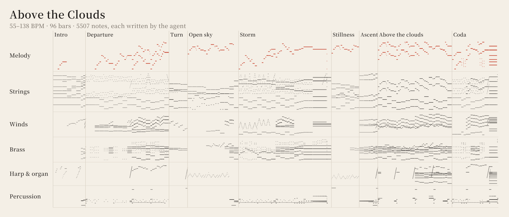

# Above the Clouds

An original concert overture for symphony orchestra and organ. Claude (Opus 5.5) composed, orchestrated and mixed it with the music-production skill. Nothing was played by hand and no audio model generated anything: `above_the_clouds.py` writes every note, and the skill renders it.

- [above_the_clouds.mp3](above_the_clouds.mp3): the whole overture, 4:28.
- [above_the_clouds_highlight.mp3](above_the_clouds_highlight.mp3): from the ascent to the end, 1:41.

<p align="center">
  
</p>

## Form

C major, 96 bars: 4:16 of music, then the hall rings out (4:28 files).

| Section | Starts | Bars | Tempo | What happens |
|---|---|---|---|---|
| Intro | 0:00 | 1–7 | 56 | Open fifths over a low C. A distant horn sings the head (G–C–D, then E); a clarinet answers in the minor; a flute takes it up high; A♭ and B♭ swell into the Allegro. |
| Departure | 0:29.8 | 8–25 | 132 | A tutti chord, then spiccato strings in 3+3+2 over timpani and low brass. The horns state the Allegro theme, built on the head; the orchestra repeats it ff with trumpet fanfares. |
| Turn | 1:02.5 | 26–29 | 126 → 86 | The head passes down through flute, oboe, clarinet and bassoon as the music slows into G major; a harp glissando. |
| Open sky | 1:11.9 | 30–40 | 76 | The big tune in the first violins over harp, the cellos, then a horn, in countermelody. Where it should climb, C minor darkens it and the tempo pushes into the storm. |
| Storm | 1:45.6 | 41–60 | 138 | The Allegro theme in C minor in horns and trombones over a galloping ostinato; the head in stretto; the theme a minor third higher; a chromatic bass to G; G7(♭9) swells, one stroke, then silence. |
| Stillness | 2:21.6 | 61–66 | 58 | A♭ major. A solo violin sings the big tune's first phrase and a solo cello answers it a bar later; a Neapolitan D♭ leads to G7. |
| Ascent | 2:46.3 | 67–70 | 66 → 70 | Over a G pedal an inner line climbs D–E♭–E–F; G7 turns deceptively to A♭, then B♭, and C breaks through. |
| Above the clouds | 3:00.6 | 71–86 | 72 | The whole big tune fff: violins in two octaves with trumpets and woodwinds, horns and bassoons in a countermelody, trombones and tuba in a chorale, bells and harp glissandi. The organ joins the second half, whose summit leans on F minor. |
| Coda | 3:55.0 | 87–96 | 132 → 78 | The head in stretto through the brass, A♭–B♭–C, the tune's F minor once more, and a held C major chord over the organ's low C. |

One four-note head (scale degrees 5–1–2, then 3) opens the horn call, the Allegro theme, the big tune, the storm and the coda, so the big tune sounds familiar when it finally arrives whole. The open sky holds it back: it plays ten bars and turns away. The places meant to move a listener follow the research on chills in music (Sloboda 1991; Grewe et al. 2007; Huron 2006): the suspension and deceptive cadence inside the tune, the withheld climb, the silence before the solo violin, the Neapolitan before G7, and the tune's full return with the organ.

## How it is played and mixed

- 53 parts on CC0 banks: section strings (each section on its own sampled range), solo violin, woodwinds, horns, trumpets, trombone, tuba, piccolo and glockenspiel from VSCO 2 Community Edition; the solo cello from Karoryfer x bigcat; timpani, orchestral percussion, harp, tubular bells and the pipe organ from VCSL.
- Balance after Rimsky-Korsakov's equivalents of strength; soft solos on tracks of their own.
- Each sustained note plays the recorded dynamic nearest its part's dynamic curve, one take per note, the curve moving its level and tone; slurred lines are joined from takes entered past their attack; bow changes on long string notes; a little portamento on the two string solos.
- Every part at its own depth on a modelled stage, the horns' bells facing the back wall, all in one generated hall. The percussion steps through the kit's recorded round robins.
- The wide master leaves out the compressors and brings the loudness range down to 12 LU by lifting the quieter passages.

## Render it yourself

Set up the renderer and the sound banks as the repository README describes, then:

```
python examples/above-the-clouds/above_the_clouds.py above_the_clouds.json 1.0.r7 --engine-r7
python skills/music-production/scripts/studio.py render above_the_clouds.json --config <folder>/local-config.studio.json --output render_overture --cache cache
python skills/music-production/scripts/studio.py analyze render_overture
```

The script writes the same project file as the one published here.

Measured on the published render (not a listening verdict):

| | |
|---|---|
| Integrated loudness | −17.0 LUFS |
| True peak | −1.8 dBTP |
| Loudness range | 12.0 LU |

## Credits and licence

The recordings and the composition are dedicated to the public domain under [CC0 1.0](https://creativecommons.org/publicdomain/zero/1.0/): use them anywhere, no credit needed. Every sound in them is CC0 as well: VSCO 2 Community Edition and VCSL (Versilian Studios) and the Karoryfer x bigcat cello (Karoryfer Lecolds and bigcat instruments). The script and the project file are code, under the repository's MIT licence.
